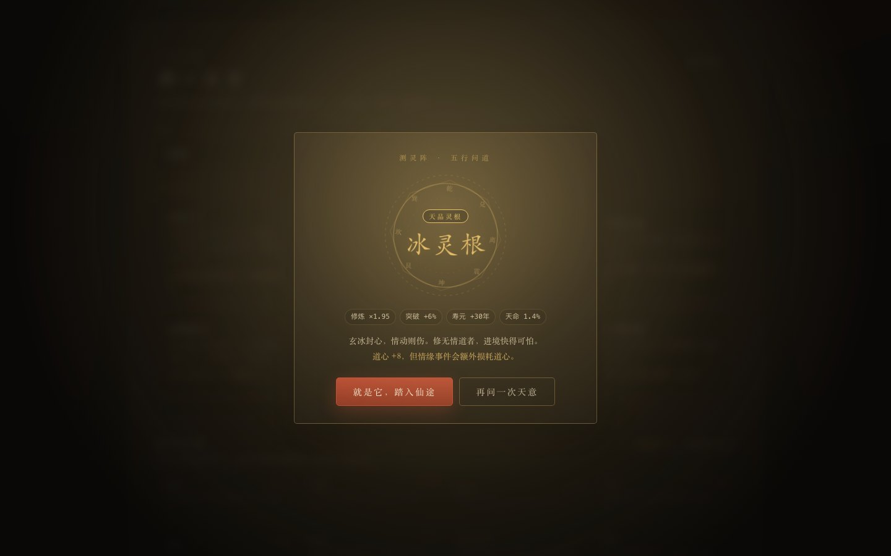
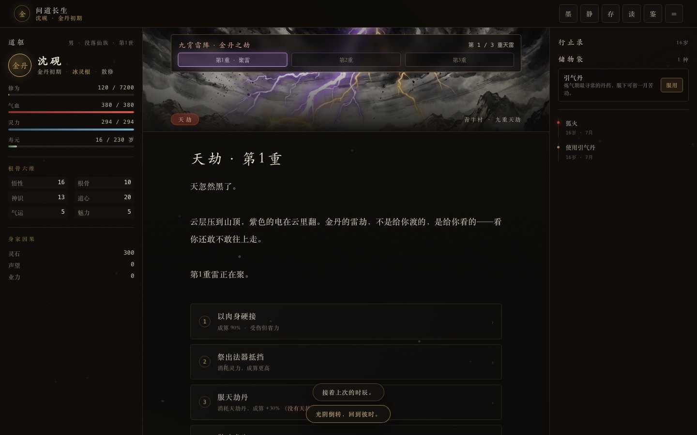
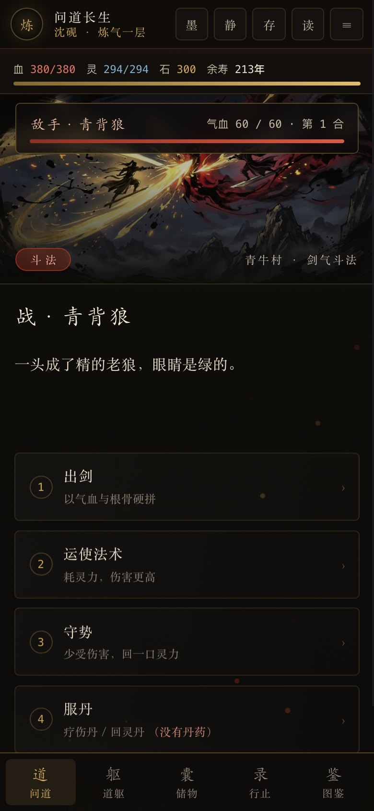

# 问道长生 · 水墨绘卷重制版 (v2.0)

一款参考 **[inkle/ink](https://github.com/inkle/ink)** 互动叙事架构打造的中文水墨修仙模拟器。抽灵根、入仙门、探秘境、炼丹药、渡天劫、历红尘百世，在有限的寿元里走出属于你自己的仙途。

纯静态网页，**零后端、零运行时依赖**，全面适配 **PC 桌面端与手机移动端**，内置 10 幅原创水墨金箔场景绘卷、灵气粒子画布、八卦测灵阵动效、天劫雷阵与斗法光效。


## 在线游玩与离线版

- **在线畅玩（GitHub Pages · 手机 / 电脑自适应）**：<https://mmppoo.github.io/wendao-changsheng-v2/>
- **直接运行源码**：`npm run serve` → 打开 <http://127.0.0.1:4173>
- **单文件离线版**：下载 [`dist/wendao-changsheng.html`](dist/wendao-changsheng.html)（内置所有代码、样式与 10 幅 WebP 插画），双击浏览器即可离线畅玩。
- **GitHub Pages 自动部署**：已内置 `.github/workflows/pages.yml`，每次推送 `main` 分支自动构建部署。

## v2.0 核心升级亮点

- **水墨绘卷与灵气动效**：原创 10 幅水墨金箔场景图（卷首山海、青牛幽居、荒野秘境、仙门问道、云桥坊市、剑气斗法、九重天劫、丹田内景、天门飞升、尘世终章），配合动态场景情绪粒子画布、八卦五行测灵盘、破境金芒、雷劫震颤、剑光斩击与可选 Web Audio 拟音。
- **电脑 + 手机双端原生体验**：
  - 桌面端（≥1100px）：三栏禅意布局（道躯六维 / 绘卷与叙事舞台 / 储物袋与行止录），支持数字键 `1–9`、空格跳过打字、`S` 存档、`L` 读档、`C` 图鉴、`Esc` 关闭弹窗，以及文字速度三档切换（墨 / 快 / 瞬）。
  - 移动端（<1100px）：顶部常驻精简修为状态条（气血/灵力/灵石/余寿/心魔/修为条）+ 底部五栏导航（问道 / 道躯 / 储物 / 行止 / 图鉴），大触控目标与零横向溢出。
- **深度修仙与 ink 织网叙事**：
  - **292 个叙事节点**：新增三大上古秘境多段织网链（昆仑残墟、归墟海眼、太古剑冢）、红尘道侣长线（苏晚晴四段式剧情）、宗门问道台大比。
  - **储物袋即时交互**：可直接服用丹药（引气丹、回灵丹、疗伤丹、洗髓丹、九转金丹）、激活护心符/神行符、参悟功法残卷。
  - **真实灵根机制**：21 种灵根各自生效（雷灵根天劫减伤、混沌灵根双倍道心奖励、空间灵根云游减半与高奇遇率、风灵根必逃、血灵根专属「燃血修行」、星辰灵根破层赠属性等）。
  - **开炉炼丹与斗法修复**：修复全部事件内嵌战斗与动态飞升结局判定，支持 24 重结局（一剑破天、丹成飞升、双宿、魔仙、看山还是山、天外归客等）与 177 项成就（含 63 项隐藏）。
  - **确定性存档与四栏图鉴**：自动存档 + 4 个手动玉简槽 + JSON 导入导出，序列化完整 RNG 状态；图鉴覆盖「成就 / 结局 / 灵根 / 宗门」。

## 100 小时游玩体量构成

| 维度 | 内容规模 | 预计体验时长 |
| --- | --- | --- |
| 单世完整仙途 | 约 500–730 回合 / 百年光阴 / 50–65 次不同奇遇 | 6–9 小时 / 世 |
| 24 重分支结局 | 正道飞升、魔道至尊、剑仙、丹圣、道侣双宿、三拒天门、红尘归隐等 | 40+ 小时 |
| 13 座宗门与 21 种灵根 | 差异化入门条件、专属功法、灵根专属行动与奇遇分支 | 25+ 小时 |
| 177 项成就与 12 项轮回天赋 | 含 63 项隐藏成就、跨世轮回构筑流派 | 30+ 小时 |

## 实机截图

| 八卦测灵根 | 桌面主界面 |
| --- | --- |
|  |  |

| 九重天劫雷阵 | 手机端竖屏斗法 |
| --- | --- |
|  |  |

## 本地开发与测试

```bash
npm run serve          # 本地启动静态服务 http://127.0.0.1:4173
npm test               # 31 项引擎与回归单元测试（node --test）
npm run validate       # 全量节点、goto、条件、物品、敌人、成就引用校验
npm run simulate       # 多种子全流程平衡模拟
npm run test:ui        # 桌面 + 移动端端到端自动化测试（基于 Chrome CDP）
npm run build          # 纯 Node 零依赖打包单文件 dist/wendao-changsheng.html
```

## 致谢

本项目在 [mmppoo/wendao-changsheng](https://github.com/mmppoo/wendao-changsheng) 的基础上进行了全面引擎修复、内容扩展、视觉绘卷重绘、动效系统及双端适配升级。

## License

MIT
