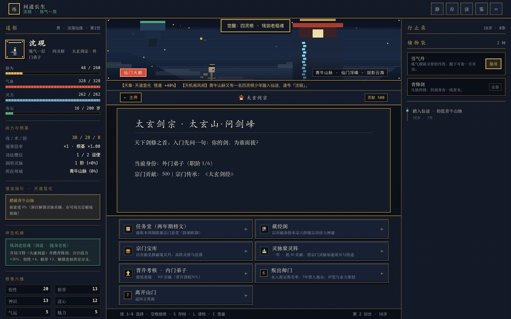

# 问道长生 · 16-bit 像素仙侠「严谨大千世界」版 (v7.0)

一款参考 **[inkle/ink](https://github.com/inkle/ink)** 互动叙事架构打造的 **16-bit HD-2D 国风像素仙侠 RPG 修仙模拟器**。零 AI 贴图、纯手工 Canvas 2D 八大州域实时像素生态画布、16×16 像素图标与双描边 RPG 框景界面、移动端 `390×844 / 375×667` 掌机级固定单屏布局；构建 **1,098 个独立叙事节点、123 重独立结局、142 部功法绝学、105 种丹药法宝、66 类特性敌手、12 位红尘道友、八大九州灵域、五层秘境探幽、六大九州天象与 270 项成就** 的真正百小时大千修真世界。


## 在线游玩与离线版

- **在线畅玩（GitHub Pages · 电脑 / 手机掌机自适应）**：<https://mmppoo.github.io/wendao-changsheng/>
- **本地启动**：`npm run serve` → 打开 <http://127.0.0.1:4173>
- **单文件离线版**：下载 [`dist/wendao-changsheng.html`](dist/wendao-changsheng.html)（42 模块零外部依赖，离线双击即玩）。

## v5.0「大千世界」全量内容规模（全部经过自动化校验 0 error）

| 世界维度 | v5.0 规模 | 核心机制 |
| --- | --- | --- |
| **ink 叙事节点** | **1,098 节点** | 覆盖八大州域多阶段奇遇链、十三宗门派系恩怨、十二道友三幕剧情、十道法则悟道、红尘王朝兴衰与心魔/天劫内景 |
| **独立结局** | **123 重结局**（含 30 隐藏） | 仙途飞升 27 / 宗门霸业 19 / 法则证果 16 / 红尘羁绊 19 / 九州宿命 21 / 劫灰陨落 21，全条件表达式校验 |
| **功法绝学** | **142 部功法** | 十三宗六阶藏经阁（78 部）+ 九州散落古修/秘境/道友传艺/古籍秘阁（64 部），凡→仙六品分级，每部附专属战斗绝招 |
| **奇珍丹器** | **105 种物品** | 十境丹药（百分比疗伤/破境/悟道）、法宝仙器、炼器灵材、符箓与可研读玉简 |
| **特性敌手** | **66 类敌手** | 覆盖炼气(0)→真仙(9)全十境，指数战力倍率（`1× → 10,000×`）+ 11 种实战特性 |
| **十三宗大殿** | **13 宗 × 完整六堂** | 78 部藏经阁典籍、104 件宝库兑换、65 项五阶悬赏、灵脉聚灵阵、5 阶晋升考核试炼与叛出师门 |
| **八大九州灵域** | **8 大梯度灵域** | 青牛山脉 → 落霞仙城 → 苍茫妖森 → 东海归墟 → 北荒魔域 → 中州圣域 → 昆仑墟界 → 九霄天门，每州专属像素生态画布 |
| **红尘道友** | **12 位常驻名修** | 苏晚晴、陆沉舟、药尘子、顾青衣、血煞老祖、林昊、云霓仙子、玄机老人、墨衡、白幽、青莲剑仙、司命星君（论道/赠礼/切磋/传艺/结侣） |
| **命途成就** | **270 项成就**（含 96 隐藏） | 6 栏命途图鉴（成就 / 结局 / 灵根 / 宗门 / 功法 / 九州）全量追踪 |

## 16-bit 像素 RPG 界面与移动端掌机体验

- **纯正 16-bit 像素化界面**：双层古金像素描边、四角像素铆钉、像素网格宣纸底纹、22 枚 16×16 锐利像素图标（`shape-rendering="crispEdges"`）与 RPG 框景对话窗。
- **八大州域专属像素实景**：青牛烟火竹村、落霞灯笼仙街、妖森毒瘴巨木、归墟海眼龙柱、北荒血月魔峰、中州浮峰剑影、昆仑星河裂隙、九霄雷劫天门实时动态点绘。
- **手机端掌机级固定单屏（`390×844` & `375×667` 双屏零溢出）**：
  - 顶部三段像素条（血 / 灵 / 修）+ 紧凑资财行（灵石 / 攻击 / 余寿 / 州域）。
  - 子界面像素面包屑导航（`← 主界 | 宗门/州域 | 贡献/灵石`）一键直达。
  - 六大零重叠支柱双列像素指令台锁底，底部五栏像素图标导航（问道 / 道躯 / 储物 / 行止 / 图鉴），无缓慢打字延迟，免频繁上下滑动。

## 实机截图

| 桌面 16-bit 像素主界面（1440×900） | 太玄剑宗 · 仙门大殿与面包屑 |
| --- | --- |
|  |  |

| 手机端固定单屏（390×844） | 手机端仙门大殿（390×844） |
| --- | --- |
|  |  |

## 开发与自动化验证

```bash
npm run serve          # 本地启动静态服务 http://127.0.0.1:4173
npm test               # 39 项引擎、P0 回归、战术斗法、秘境探幽、指数战力、宗门与世界规模单元测试
npm run validate       # 1,098 节点 + 123 结局 + 142 功法 + 105 物品 + 66 敌手 + 270 成就 + 8 丹方全校验（0 error）
npm run simulate       # 多种子千载修行平衡与时长模拟
npm run test:ui        # 三视口（1440×900 / 390×844 / 375×667）15 项端到端实机测试（Chrome CDP）
npm run build          # 纯 Node 零依赖打包单文件 dist/wendao-changsheng.html
```

## 变更记录

- **v7.0.0（全量排雷零 Bug + 可玩性深度跃迁）**：
  - **P0/P1 严重 Bug 彻底清除**：修复 8 套配方炼丹不产出丹药（`rec.outputId`）；修复 414 条非致死事件战败后点击继续 0 血暴毙；修复前端含 `hideIf` 选项列表点错后续按钮（`ch.index`）；修复 `expr.js` `null` 字面量与 `hasItem` 数量校验；修复天劫前置补满血灵与法宝抗劫灵力校验；修复主线强插吞没当前奇遇结果/一次性秘境；修复逆命天赋突破后失效（`permBreakBonus`）；修复读档覆盖跨世轮回进度（`mergeMeta`）；补齐 11 阶本命法宝使 `craft>=10` 成就可达、解除 12 个被硬编码遮蔽的陨落/渡劫/凡人结局，并修复十余项宗门/灵根/道友/法宝/存档与移动端 UI 细节缺陷。
  - **战术斗法 2.0**：敌手每回合明示「行动意图」（重击蓄势 / 疗伤回血 / 特性绝技 / 常规攻伐）；预判重击施展「守势」触发 1.55× 必爆「蓄势反击」；新增 5 种「御符」破甲并打断敌手蓄势/疗伤；新增每战一次「法则领域」爆发 + 三回合攻防增幅。
  - **五层秘境探幽（Roguelike 爬塔）**：八大州域各具专属五层古境，逐层递进 `1.0×→3.5×` 灵石与天材地宝掉落（死斗守卫、机关宝箱、残碑悟道、五层镇守 Boss），随时可「见好就收」全额落袋或险境应急遁走保底半数战利品。
  - **六大九州天象与道途指引**：每 30–45 年自动轮转「灵气潮汐 / 妖潮动荡 / 丹器盛会 / 万宝商潮 / 天道显化 / 劫云暗涌」，全局动态联动修炼、炼丹、坊市、法则与破境；主界面与道躯栏新增实时「道途指引」与洞府「闭关冲层（智能出关）」。
  - **体验与交互优化**：古籍秘阁支持品阶筛选与分页、功法运使支持「一键择优」、商行收购支持「一键清售多余凡黄灵材」、道友赠礼支持多礼自选、成就解锁 Toast 顶置永不遮挡底部选项。
- **v6.0.0（全源码严谨审计重构）**：
  - **数值与功法槽位防崩坏**：功法实行 2→6 槽运使制（收藏功法仅提供封顶 +15% 武道底蕴，杜绝 76 本线性叠到 ×31）；全 142 部功法补齐 `正/中/邪` 阵营与混修真气冲突惩罚；寿元分源封顶（功法 ≤200 年、法则 ≤300 年、外源丹药 ≤50% 基础寿元）+ 琥珀/朱砂双级寿元预警。
  - **经济与外围闭环**：十年一届限量 4 件溢价竞价拍卖（含 NPC 抬价竞争）、商行/秘阁/拍卖统一天机镜折扣、亚线性敌手灵石曲线、洞府 1→9 阶灵脉升级、十阶本命法宝全境百分比加成与最低价省料优先、8 套自选丹方开炉、4 灵兽 1→5 阶养成全属性生效、问道擂台与 500 条行止录 `.txt` 传记导出。
  - **宗门与道友严谨化**：按境界礼聘入宗（化神直授长老）、晋升真实消耗 50% 贡献、叛门永久黑名单 + 5 年禁入冷却、每两年刷新 3 席限量任务板、真正「开宗立派」自建 1→5 阶山门收徒收岁贡、秘境严格校验入场条件；12 位红尘道友全部实装专属论道、按物价计好感赠礼、12 部唯一亲传绝学从秘阁剥离、多道友结侣。
  - **成就、结局与日志全可达**：修复跨世死亡计数 `meta.totalDeaths`、拒飞升条件口径（`realm >= 8`）与代价、11 个被遮蔽结局、去重秘境计数、全 45 妖魔斩妖统计、开坛讲道/广收门徒计数，并打通成就奖励轮回点与统一修真纪年。
- **v5.0.0（大千世界）**：事件节点扩充至 **1,098 个**、结局扩充至 **123 重**、功法扩充至 **142 部**、物品 **105 种**、敌手 **66 类**、道友 **12 位**、成就 **270 项**；新增古籍秘阁、道友传艺、6 栏命途图鉴；全面升级为 **16-bit 像素 RPG 界面**（22 枚 16×16 像素图标、八大州域像素生态画布、RPG 框景对话窗、移动端三段像素血/灵/修 HUD 与子界面面包屑，通过 `390×844` 与 `375×667` 双屏零溢出验证）。
- **v4.0.0**：十境指数战力体系（`1×→10,000×`）、大境瓶颈与道基/金丹品质、十道天地法则、六大零重叠支柱与十三宗完整仙门大殿。
- **v3.1.0**：去除缓慢打字特效、移动端 `100dvh` 固定单屏与仙侠文风润色。
- **v3.0.0**：转向纯手工 HD-2D 像素实景画布（彻底去除 AI 贴图）、新增 6 大伴生机缘与网文深度玩法。

## License

MIT
