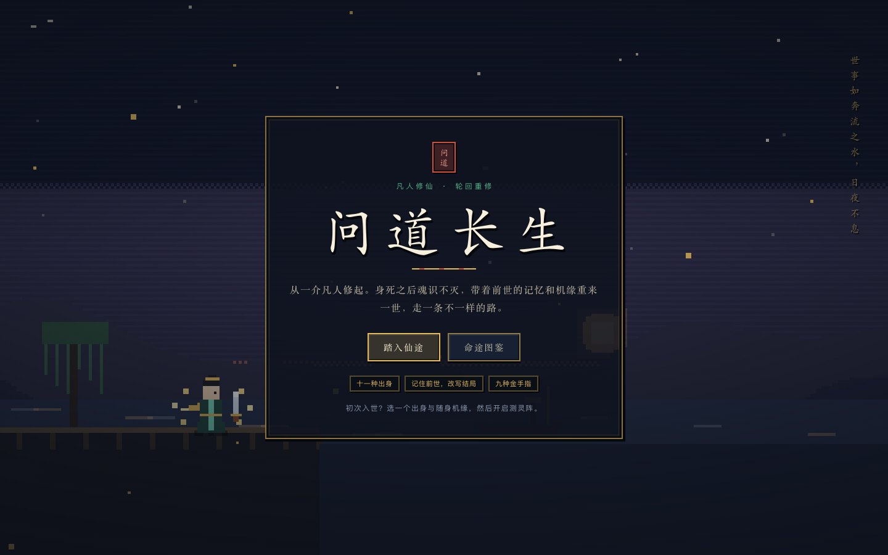
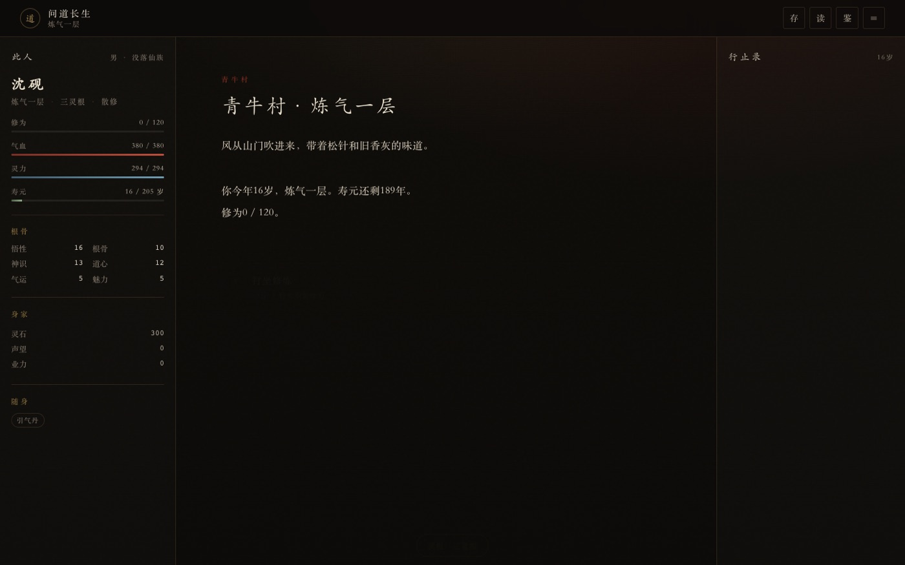

# 问道长生 · Wendao Changsheng

一款用 **ink 式节点叙事** 写成的中文修仙模拟器。抽灵根、入宗门、闯秘境、渡天劫，在有限的寿元里决定这一世怎么活。纯静态网页，无后端、无依赖、无构建步骤，打开即玩。



## 怎么玩

- **在线玩（GitHub Pages）**：<https://mmppoo.github.io/wendao-changsheng/>
- **下载单文件**：[Release 单文件版](https://github.com/mmppoo/wendao-changsheng/releases/download/v1.0.0/wendao-changsheng.html) → 双击 → 浏览器打开即可。离线可玩，存档在本地。

其他方式：

- 仓库内单文件：[`dist/wendao-changsheng.html`](dist/wendao-changsheng.html)（右键另存为，`npm run build` 可重新生成）
- 源码：`npm run serve` → <http://127.0.0.1:4173>
- 自建部署：仓库带 `.github/workflows/pages.yml`，Settings → Pages 选 GitHub Actions 即自动部署（fork 后同样适用）

> 单文件版由 bun 打包并把 CSS/JS 内联，运行时零依赖；源码版是无构建的 ES module，方便改内容。

## 它是什么

不是挂机游戏，也不是卡牌。每一回合你站在一个叙事节点上，读一段文字，做一次选择；选择会改变属性、物品、关系、业力，也会改变几十年后你能触发的结局。灵感直接来自 [inkle/ink](https://github.com/inkle/ink) 的 knot / choice / divert 结构，以及《太吾绘卷》《修仙模拟器》那类「一生一局」的叙事密度。

### 核心系统

| 系统 | 内容 |
| --- | --- |
| 灵根抽取 | 21 种灵根，从五灵根到混沌灵根，权重不同，决定修炼速度与突破加成 |
| 出身 | 11 种出身：农家子、没落仙族、皇室、药商、孤儿、书生、猎户、侠客、魔道遗孤、器灵转世、天外之人 |
| 境界 | 10 大境界 × 3–9 层，炼气 → 筑基 → 金丹 → 元婴 → 化神 → 炼虚 → 合体 → 大乘 → 渡劫 → 真仙 |
| 突破 | 修为满后可冲关，成功率由道心、灵根、丹药、伤势决定；大境界必渡三重天劫 |
| 宗门 | 13 个宗门（正 / 中 / 邪 / 散修），6 级晋升，宗门专属事件与功法 |
| 奇遇 | 270+ 叙事节点，按境界、灵根、宗门、flag 过滤后加权抽取；气运影响高 tier 概率 |
| 战斗 | 叙事化回合战斗：出剑 / 法术 / 防御 / 服丹 / 遁走，胜负写入后续剧情 |
| 成就 | 177 项，其中 63 项隐藏；条件跨越单局与轮回 |
| 结局 | 24 个结局，按优先级判定：飞升、兵解、魔化、寿终、归隐、功德、双宿…… |
| 存档 | 4 个手动槽 + 自动存档，可导出 / 导入 JSON；随机数状态一并保存，读档后卦象不变 |
| 轮回 | 死亡或飞升后进入下一世，解锁 12 项永久天赋（宿慧、剑心、逆命、天外残卷……） |

## 操作

- 鼠标点选项，或按 `1`–`9` 选择
- `S` 存档面板，`Esc` 关闭面板
- 顶部「图鉴」查看成就与结局；「命途」查看本世履历
- 存档在浏览器 localStorage，键名前缀 `wendao.v3.`

## 运行与开发

```bash
npm run serve          # python3 -m http.server 4173
npm test               # 引擎单测（node --test）
npm run validate       # 内容校验：id / goto / 条件 / 引用
npm run simulate       # 多种子全流程模拟，输出平衡数据
npm run test:ui        # Playwright 端到端（需先 serve）
```

无构建步骤：`index.html` 直接加载 ES module。所有内容在 `src/data/`，所有规则在 `src/engine/`。

### 目录

```
index.html            单页入口
styles/main.css       纸墨 / 朱砂视觉系统
src/engine/           rng, expr, state, effects, narrative, game, save
src/data/             境界 / 灵根 / 出身 / 宗门 / 物品 / 敌人 / 成就 / 结局 / 事件
src/data/events/      wild, world, sect, inner, story + 三个扩容包
tests/                engine.test.mjs, validate.mjs, simulate.mjs, ui.spec.mjs
docs/                 DESIGN.md（ink 映射与架构）, CONTENT_SCHEMA.md（写事件）
```

## 关于 100 小时

这不是一句口号，是按「一世 6–9 小时 × 多周目」估出来的：

| 内容 | 量 | 折算 |
| --- | --- | --- |
| 单周目 | ~600 次选择 / 120–200 年 / 50+ 个不同事件 | 6–9 h |
| 24 个结局 | 每个结局需要不同路线（宗门、业力、道心、关系） | +40 h |
| 12 条宗门路线 | 每个宗门 2–3 条专属事件链 + 独有晋升任务 | +20 h |
| 177 项成就 | 含 63 项隐藏、跨轮回累计 | +24 h |
| 轮回天赋 | 12 项永久天赋改变开局与流派 | +12 h |

模拟器（`npm run simulate`）在 10 个种子上给出的均值：**649 次选择 / 128 年 / 63 个不同事件 / 33 项成就**。按每次选择 35–50 秒的阅读与决策，单周目约 7 小时。

## 截图

| 抽灵根 | 主界面 |
| --- | --- |
|  |  |

## 设计文档

- [ink 映射与引擎架构](docs/DESIGN.md)
- [事件编写规范](docs/CONTENT_SCHEMA.md)
- [测试与平衡记录](docs/PLAYTEST.md)

## License

MIT
