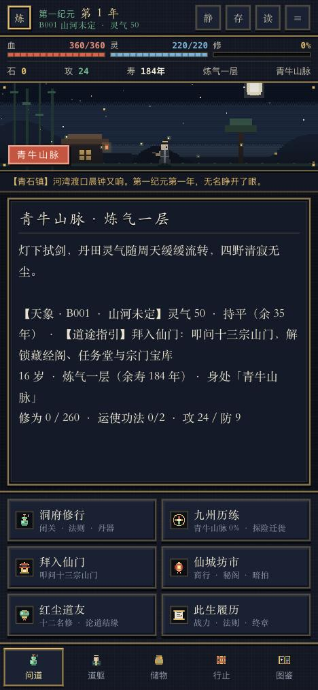

# 问道长生 · 宁朝五域（v8.2）

一款像素风格的修仙文字游戏。故事发生在宁朝五域的第一纪元：从第 1 年南泽青石镇的河湾渡口开始，到第 10000 年纪元终结，每百年一章，共一百章。开局可选 **11 大经典网文流派出身**（退婚废柴、凡人苟修、冷宫弃子、鉴宝神豪、苟道野修、文道才子、杀伐体修、拔剑弃徒、魔尊借壳、古剑化形、穿书先知，筑基后更有专属「风水轮流转」归来清算）与 **9 大金手指**；配备 **气机姿态（敛息藏锋 / 顺其自然 / 威压外放）**、**恩怨簿登门清算**、**六大靠山势力威慑**、**坊间盛会（赌石鉴宝 / 丹器斗法 / 天骄茶会）** 与 **千变因果打脸剧本引擎**。人死之后，魂识回到第 1 年，带着前世手札重走同一段历史，改写本来会发生的大事。



## 在线游玩与离线版

- **在线游玩（GitHub Pages，电脑、手机均可）**：<https://mmppoo.github.io/wendao-changsheng/>
- **本地启动**：`npm run serve` → 打开 <http://127.0.0.1:4173>
- **单文件离线版**：下载 [`dist/wendao-changsheng.html`](dist/wendao-changsheng.html)，双击即可离线游玩。

## 核心玩法

| 系统 | 说明 |
| --- | --- |
| 万年大历史 | 第一纪元百章，726 件按年份发生的大事，含末法与机巧年代；身在当地即亲历，不在场则以风闻传来 |
| 轮回与前世手札 | 死后回到第 1 年，世界重置、记忆保留；手札记下的大事再次发生时可提前应对，改写成功记入「历史已改写」 |
| 不飞升 | 渡劫成真仙后仍留在五域，寿元极长，可活过灵气兴衰与机巧兴起 |
| 宿敌 | 每世一位宿敌，6 种出身、5 段剧情 |
| 出身与金手指 | 11 种经典网文流派出身（退婚流/凡人流/废太子/鉴宝神豪/剑修弃徒/魔尊借壳/器灵重修/穿书先知等）各有开场；9 种金手指全可选 |
| 气机姿态与千变打脸引擎 | 随时切换「敛息藏锋 / 顺其自然 / 威压外放」；32 大场景 × 4 档修为差 × 11 出身 × 9 金手指 × 地域靠山二段护短 × 同门清理门户，严守逻辑、千万种合理打脸与装逼应对 |
| 恩怨簿与势力威慑 | 弱势暂避或斗法吃瘪记入「恩怨簿」，破境后可随时登门清算或狭路相逢翻盘；反复教训同一靠山可令其「闻风丧胆」不战而屈 |
| 坊间盛会与流派归来 | 市集每年可赴「赌石鉴宝 / 丹器斗法 / 天骄茶会」凭真本事与敛息反差打脸夺彩；全部 11 种出身筑基后触发专属「风水轮流转」清算大戏 |
| 轮回成长 | 天赋五重、劫数 0–12、前世遗泽择物带入来世 |
| 纪元终局 | 第 10000 年按此前改写的走向，进入五种纪元结局之一 |

## 内容规模（`npm run validate` 校验，0 错误）

| 项目 | 数量 |
| --- | --- |
| 在用事件节点 | 1,158（另有 741 个旧版九州事件已停用） |
| 大历史事件 | 737 |
| 结局 | 170 |
| 成就 | 309（含 99 个隐藏） |
| 功法 | 142 |
| 物品 | 105 |
| 敌手 | 96 |
| 故人 | 12 |
| 可投身势力 | 13 |

世界设定以 [`docs/WORLD_CANON.md`](docs/WORLD_CANON.md) 为准。

## 开发与自动化验证

```bash
npm run serve          # 本地启动静态服务 http://127.0.0.1:4173
npm test               # 47 项引擎单元测试（含 v8.2 逻辑消冲突/恩怨簿/威慑/盛会/11流派归来 + v8.1/v8 全套）
npm run validate       # 全部事件、32 大打脸场景、结局、成就、功法、物品、敌手校验（0 error）
npm run simulate       # 多种子平衡模拟
node tests/playtime.mjs 80   # 多世轮回时长估算
npm run test:ui        # 三视口（1440×900 / 390×844 / 375×667）15 项端到端实机测试（Chrome CDP）
npm run build          # 纯 Node 零依赖打包单文件 dist/wendao-changsheng.html
```

## 变更记录

- **v8.2.1（游玩逻辑审查）**：
  - 凡人场景的事件补上境界上限：元婴、化神不会再被护院砸晕、被差役架出县衙、在码头扛包。
  - 没敛息却被低境界的人挑衅，文中写明缘由：要么境界差太远看不出深浅，要么家底厚有恃无恐（后者更爱喊长辈来护短）。
  - 恩怨簿里的仇人按其境界寿元老死，不会几百年后还去找一个炼气散修算账。
  - 筑基归来剧情去掉写死的「两年前」（实测筑基多在第 28—77 年）；第 45 年后才筑基的，开局那些凡俗故人多已不在，改走「物是人非」。
  - 归来剧情里对方会看穿你的修为：敛息着的话，此时自动散去敛息并交代一句。
  - 写到「你家祖田」「驱逐你的山门」「你的月例」的遇事，要求主角真有这段过去或这个身份；「当年恩怨」类一世一次。
- **v8.2.0（逻辑消冲突 + 恩怨簿、势力威慑、坊间盛会与 11 流派归来）**：
  - **6 处隐性逻辑冲突彻底消除**：靠山势力按五域地理归属生成（西陲沙盗不出南泽，芦洲黑风寨不出北境）；本门高阶长老遇本门执事一脉挑衅新增「清理门户 · 上官查岗」分支，不再被当成野散修；护短长老头衔与灵压文案动态匹配真实境界；出身与金手指失手转入斗法时完整承接专属台词；斗法胜果道心严格计入每大境属性总额度（8 点封顶）；敛息状态下高一境对手识破伪装与「龟息藏锋诀」瞒过半分的逻辑细致区分。
  - **恩怨簿 · 登门清算与狭路相逢**：弱势暂避或遇事斗法失利时自动记下对方姓名、靠山与年份；破境后可在「市集坊间 → 恩怨簿」主动登门清算，或在同地行走时狭路相逢一了百了（每笔旧账仅可清算一次）。
  - **六大靠山势力威慑度**：教训小辈 +1、收拾护短长老 +2；威慑达 2 重时对方门客暗中发虚，达 4 重时直接解锁「闻风丧胆 · 不战而屈」（每势力一年冷却防刷）。
  - **坊间盛会（赌石鉴宝 / 丹器斗法 / 天骄茶会）**：市集坊间新增三大年度盛会（各自 12 个月冷却），真实读取神识/气运/鉴宝流/天机镜、炼丹炉数/法宝阶数/火灵根/小绿瓶、根基品质/法则/敛息末席反差。
  - **11 大流派筑基归来里程碑事件**：全部 11 种出身在筑基之后各自触发专属「风水轮流转」归来打脸剧情（昔日退婚管事、东宫太监、夺权二叔、旧武馆师兄、原书气运少年等尽数呼应），并新增 6 项里程碑成就（总成就 323 项）。
- **v8.1.1（遇事漏洞修复）**：
  - 遇事斗法中逃走后风波不了结，会一直挡住大灾与剧情触发：已修。
  - 金手指底牌原先百分之百成功：对高一境的人约一半失手，转入斗法。
  - 反复「坊间走动」可无限刷道心、灵石：遇事所得属性每个大境界至多 +8；短时间连着惹事，所得递减（每半年消退）。
  - 「暂避离去」不再白送悟性；普通斗法胜负不再白送属性。
  - 门户差事、走遍一地的奖励被遇事吞掉不显示：改为写在遇事开头。
  - 「威压外放」原先比另两种姿态全面吃亏：改为闲逛少遇挑衅与野怪。
- **v8.1.0（网文诸派与千变因果打脸矩阵）**：
  - **11 大熟悉网文流派出身与专属开场**：重塑全部 11 种出身（退婚废柴·昔日炼气八层跌境、凡人苟修、冷宫弃子、鉴宝神豪、苟道野修、文道才子、杀伐体修、拔剑弃徒、魔尊借壳、古剑化形、穿书先知），自然融入「两年前魂穿/重生入体、神魂初合停滞两年」的共通因果，开局即入对应流派名场面。
  - **气机姿态系统（敛息 / 如常 / 外放）**：洞府与道躯栏均可一键零耗时切换「敛息藏锋（对外压低 1–3 境，专钓不长眼之辈扮猪吃虎）」「顺其自然」「威压外放（宵小望风披靡、同阶天骄与老怪来试锋）」。
  - **千变因果「打脸·装逼·博弈」动态剧本引擎**：32 个手工打磨的宁朝五域网文冲突场景（婚约家门、酒楼拍卖、宗门测灵、秘境抢宝、炼丹鉴宝、权贵官府、天骄老怪、归乡清算）× 4 档精确境界差（远高于/高于/同境/低于）× 3 气机姿态 × 11 出身专属反制 × 9 金手指降维打脸 × 门户尊位身份 × 6 大宁朝靠山「打了小的来老的」二段护短连环打脸，构成百万至千万级逻辑严密的分支应对。
  - **严守逻辑合理性**：低阶对手挑衅高阶主角皆有「敛息未散 / 返璞归真看不透 / 仗势眼瞎」合理解释；主角修为低于对手时硬亮境界不会无脑震慑，须靠根基底蕴、智谋套话、出身/金手指底牌或硬核越阶斗法翻盘。
  - **8 项打脸里程碑成就**：新增「莫欺少年穷」「扮猪吃虎」「一威镇全场」「打了小的来老的」「以弱逆伐」等成就（总成就 317 项）。
- **v8.0.0（宁朝五域）**：
  - 世界整个换成《长生模拟器》最早剧本：宁朝五域、第一纪元万年百章；地区、势力、故人、功法来源、秘境、结局、成就全部改写。
  - 新增大历史引擎、前世手札、先知与改写、宿敌线、纪元终局；轮回改为回到第 1 年。
  - 新增轮回成长：天赋五重、劫数、出身与机缘解锁、前世遗泽。
  - 修复：属性被刷到上千、天劫几乎必过、宗门任务连刷顶档、灵脉与买卖刷钱、喂兽与祭炼折抵、论道与切磋无冷却、单文件版启动报错等。
  - 顶栏常驻「第一纪元 · 第 N 年」与当前篇章。
- **v7.0.0（全量排雷零 Bug + 可玩性深度跃迁）**：
  - **P0/P1 严重 Bug 彻底清除**：修复 8 套配方炼丹不产出丹药（`rec.outputId`）；修复 414 条非致死事件战败后点击继续 0 血暴毙；修复前端含 `hideIf` 选项列表点错后续按钮（`ch.index`）；修复 `expr.js` `null` 字面量与 `hasItem` 数量校验；修复天劫前置补满血灵与法宝抗劫灵力校验；修复主线强插吞没当前奇遇结果/一次性秘境；修复逆命天赋突破后失效（`permBreakBonus`）；修复读档覆盖跨世轮回进度（`mergeMeta`）；补齐 11 阶本命法宝使 `craft>=10` 成就可达、解除 12 个被硬编码遮蔽的陨落/渡劫/凡人结局，并修复十余项宗门/灵根/道友/法宝/存档与移动端 UI 细节缺陷。
  - **战术斗法 2.0**：敌手每回合明示「行动意图」（重击蓄势 / 疗伤回血 / 特性绝技 / 常规攻伐）；预判重击施展「守势」触发 1.55× 必爆「蓄势反击」；新增 5 种「御符」破甲并打断敌手蓄势/疗伤；新增每战一次「法则领域」爆发 + 三回合攻防增幅。
  - **五层秘境探幽（Roguelike 爬塔）**：八大州域各具专属五层古境，逐层递进 `1.0×→3.5×` 灵石与天材地宝掉落（死斗守卫、机关宝箱、残碑悟道、五层镇守 Boss），随时可「见好就收」全额落袋或险境应急遁走保底半数战利品。
  - **六大九州天象与道途指引**：每 30–45 年自动轮转「灵气潮汐 / 妖潮动荡 / 丹器盛会 / 万宝商潮 / 天道显化 / 劫云暗涌」，全局动态联动修炼、炼丹、坊市、法则与破境；主界面与道躯栏新增实时「道途指引」与洞府「闭关冲层（智能出关）」。
  - **体验与交互优化**：古籍秘阁支持品阶筛选与分页、功法运使支持「一键择优」、商行收购支持「一键清售多余凡黄灵材」、道友赠礼支持多礼自选、成就解锁 Toast 顶置永不遮挡底部选项。
- **v6.0.0（全源码严谨审计重构）**：
  - **数值与功法槽位防崩坏**：功法实行 2→6 槽运使制（收藏功法仅提供封顶 +15% 武道底蕴，杜绝 76 本线性叠到 ×31）；全 142 部功法补齐 `正/中/邪` 阵营与混修真气冲突惩罚；寿元分源封顶（功法 ≤200 年、法则 ≤300 年、外源丹药 ≤50% 基础寿元）+ 琥珀/朱砂双级寿元预警。
  - **经济与外围闭环**：十年一届限量 4 件溢价竞价拍卖（含 NPC 抬价竞争）、商行/秘阁/拍卖统一天机镜折扣、亚线性敌手灵石曲线、洞府 1→9 阶灵脉升级、十阶本命法宝全境百分比加成与最低价省料优先、8 套自选丹方开炉、4 灵兽 1→5 阶养成全属性生效、问道擂台与 500 条行止录 `.txt` 传记导出。
  - **宗门与道友严谨化**：按境界礼聘入宗（化神直授长老）、晋升真实消耗 50% 贡献、叛门永久黑名单 + 5 年禁入冷却、每两年刷新 3 席限量任务板、真正「开宗立派」自建 1→5 阶山门收徒收岁贡、秘境严格校验入场条件；12 位红尘道友全部实装专属论道、按物价计好感赠礼、12 部唯一亲传绝学从秘阁剥离、多道友结侣。
  - **成就、结局与日志全可达**：修复跨世死亡计数 `meta.totalDeaths`、拒飞升条件口径（`realm >= 8`）与代价、11 个被遮蔽结局、去重秘境计数、全 45 妖魔斩妖统计、开坛讲道/广收门徒计数，并打通成就奖励轮回点与统一修真纪年。
- **v5.0.0（大千世界）**：事件节点扩充至 **1,098 个**、结局扩充至 **123 重**、功法扩充至 **142 部**、物品 **105 种**、敌手 **66 类**、道友 **12 位**、成就 **270 项**；新增古籍秘阁、道友传艺、6 栏命途图鉴；全面升级为 **16-bit 像素 RPG 界面**（22 枚 16×16 像素图标、八大州域像素生态画布、RPG 框景对话窗、移动端三段像素血/灵/修 HUD 与子界面面包屑，通过 `390×844` 与 `375×667` 双屏零溢出验证）。
- **v4.0.0**：十境指数战力体系（`1×→10,000×`）、大境瓶颈与道基/金丹品质、十道天地法则、六大零重叠支柱与十三宗完整仙门大殿。
- **v3.1.0**：去除缓慢打字特效、移动端 `100dvh` 固定单屏与仙侠文风润色。
- **v3.0.0**：转向纯手工 HD-2D 像素实景画布（彻底去除 AI 贴图）、新增 6 大伴生机缘与网文深度玩法。

## License

MIT
